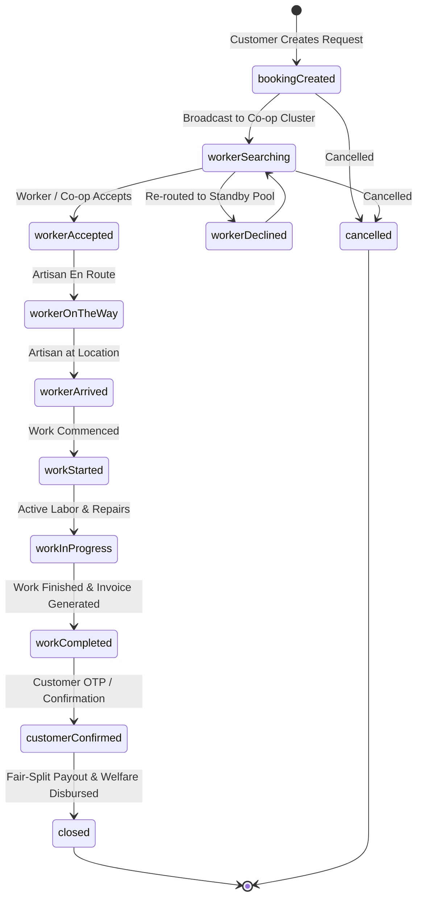

# 🤝 CoopService — Cooperative Gig Services Platform

[](https://flutter.dev)
[](https://dart.dev)
[](https://riverpod.dev)
[](https://pub.dev/packages/go_router)
[](https://firebase.google.com)
[-2D6A4F)](#-bilingual-internationalization)
[](LICENSE)
[](#-getting-started)

> **"Democratizing the Gig Economy through Worker-Owned Cooperatives."**  
> *Trusted services. Fair work. Strong communities.*

---

## 📖 Table of Contents

- [🌿 The Paradigm Shift](#-the-paradigm-shift)
- [⚖️ The Fair-Split Economic Model](#️-the-fair-split-economic-model)
- [✨ Key Features & Ecosystem Portals](#-key-features--ecosystem-portals)
  - [🏡 1. Customer Portal](#1--customer-portal)
  - [🛠️ 2. Worker / Artisan Portal](#2-️-worker--artisan-portal)
  - [🏢 3. Cooperative Admin Portal](#3--cooperative-admin-portal)
  - [🏛️ 4. Super Admin (State Federation) Portal](#4-️-super-admin-state-federation-portal)
- [🔄 End-to-End Booking Lifecycle](#-end-to-end-booking-lifecycle)
- [🗂️ Project Architecture & Directory Structure](#️-project-architecture--directory-structure)
- [🎨 Design Language & Aesthetic](#-design-language--aesthetic)
- [🌐 Bilingual Internationalization](#-bilingual-internationalization)
- [🚀 Getting Started & Demo Guide](#-getting-started--demo-guide)
- [🔮 Future Roadmap](#-future-roadmap)
- [👩‍💻 Author & Community](#-author--community)

---

## 🌿 The Paradigm Shift

Traditional on-demand gig platforms extract **20% to 35% in commissions**, penalize workers through opaque automated algorithms, disconnect technicians from their local community, and leave independent contractors without healthcare, tool financing, or emergency safety nets.

**CoopService** dismantles this extractive model. It provides a community-first digital ecosystem connecting conscious consumers with **democratically owned worker trade cooperatives** (electricians, plumbers, carpenters, HVAC technicians, painters, and homecare artisans).

```
   TRADITIONAL GIG PLATFORMS                  COOPSERVICE FEDERATED MODEL
  ┌───────────────────────────┐             ┌───────────────────────────────────┐
  │  Customer Pays: ₹1,000    │             │  Customer Pays: ₹1,000            │
  ├───────────────────────────┤             ├───────────────────────────────────┤
  │  Platform Cut:    ~25-35% │             │  👷 Worker Payout:     85% (₹850) │
  │  Hidden Surges & Fees     │             │  🛡️ Guild Welfare Fund: 12% (₹120) │
  │  Worker Gets:     ~65-75% │             │  🌐 Platform Support:    3% (₹30) │
  │  Social Cover:         0% │             │  Co-op Dividends:     ✅ Included  │
  └───────────────────────────┘             └───────────────────────────────────┘
```

---

## ⚖️ The Fair-Split Economic Model

At the core of the platform is an immutable, 100% transparent pricing architecture:

- 👷 **85% Direct Worker Payout**: Dispatched directly to the certified artisan upon customer confirmation.
- 🛡️ **12% Cooperative Welfare & Tool Fund**: Retained by the member-run cooperative to finance:
  - **National Co-op Health Shield** and accident insurance.
  - **Zero-interest tool grants** and gear upgrade loans.
  - **Apprenticeship stipends** for young artisans and women in trades.
  - **Annual profit dividends** redistributed democratically to all guild members.
- 🌐 **3% Platform Maintenance & Network Support**: Strict at-cost operational fee dedicated solely to server hosting, map services, verification infrastructure, and SMS gateways.

---

## ✨ Key Features & Ecosystem Portals

CoopService provides four interconnected portal experiences inside a single, unified Flutter codebase:

### 1. 🏡 Customer Portal

Designed for neighborhood transparency, trust, and community solidarity:

* **Neighborhood Co-op & Worker Discovery**: Real-time interactive map and cluster discovery showcasing local guild technicians with verified ratings, hourly base rates, and active standby counts.
* **Skill Provenance & Audit Trail**: Inspect verifiable trade credentials, issuing bodies (e.g., *Tamil Nadu Skill Development Corp*, *ITI Guindy*), practical competency scores, and certifying officer logs.
* **Transparent Fair-Split Breakdown**: Full visibility of every rupee split (Worker, Welfare Fund, Platform) before confirming any appointment.
* **Emergency Priority Standby**: Rapid dispatch mode (<20 min response) for urgent short-circuits, burst pipelines, and electrical hazards.
* **Group & Society Bookings**: Multi-resident apartment complex scheduling that splits logistics costs evenly across participating households.
* **Recurring Care Plans**: Pre-scheduled seasonal maintenance (monsoon electrical audits, quarterly AC servicing, sump tank hygiene) with designated dedicated technicians.
* **Digital Service Vault & Warranty Revisit Guarantee**: Secure repository of all past service records, warranty certificates, parts invoices, and 1-tap "Claim Free Re-Visit Guarantee" requests.
* **Ask Guild Coordinator**: In-app direct line with the cooperative’s local trade supervisor for estimates, complex scopes, and custom quotes.
* **My Community Impact Tracker**: Real-time metrics highlighting how much income the customer has directed to local working families and cooperatives engaged.

---

### 2. 🛠️ Worker / Artisan Portal

Engineered to protect artisan dignity, agency, and earnings:

* **Live Dispatch & Requests**: Real-time dispatch interface with instant accept/decline, distance radius, job specifications, and guaranteed payouts.
* **Earnings & Dividend Dashboard**: Transparent tracking of daily, weekly, and cumulative earnings, alongside accrued cooperative welfare dividends.
* **Structured Job Execution Flow**: Interactive job lifecycle management with step-by-step phases: *Accepted ➔ On The Way ➔ Arrived ➔ Work In Progress ➔ Work Completed*.
* **Guild Welfare & Health Shield**: Active monitoring of union insurance policies, health coverage status, emergency relief claims, and apprenticeship hours.
* **Skill Badges & Trade Endorsements**: Verifiable directory of completed certifications and guild supervisor verifications.
* **Shift & Availability Manager**: Flexible control over working hours across morning, afternoon, and evening shifts without fear of algorithmic deactivation.

---

### 3. 🏢 Cooperative Admin Portal

Empowering local trade society leaders to manage their clusters:

* **Executive Guild Dashboard**: Monthly booking volume, active field technicians, revenue charts, and operational key performance indicators.
* **Worker Onboarding & Verification Queue**: Review and verify trade licenses, government ITI credentials, practical test evaluations, and police clearances.
* **Dynamic Job Assignment Engine**: Reassign bookings, resolve dispatch bottlenecks, and assign guild standby teams to emergency calls.
* **Guild Financial Ledger & Reserve Fund**: Real-time ledger tracking worker payouts, welfare fund reserves, tool stipend disbursements, and platform maintenance expenses.
* **Cooperative Impact Stories**: Publish community initiatives (e.g., *Monsoon Flood Electrical Relief Drive*, *Women in Trades Apprenticeships*) directly onto the public cooperative profile.

---

### 4. 🏛️ Super Admin (State Federation) Portal

State-wide federation oversight, consumer protection, and macro analytics:

* **Federation Analytics**: Statewide overview of registered cooperatives, active workers, customer satisfaction indices, and completed work volume.
* **AI Demand Forecasting Engine**: Heuristic and predictive machine learning models forecasting regional trade spikes based on seasonal weather (monsoon surges, summer heatwaves), municipal infrastructure shifts, and historical trends.
* **Standardized Service Catalog**: Centralized governance of base service rates, standard time allocations, and minimum fair wage floors.
* **Dispute Arbitration Center**: Tiered conflict resolution interface with evidence inspection, customer statements, technician logs, and fair arbitration remedies.
* **Comprehensive Audit Trail**: Immutable logging of all credential approvals, rate adjustments, status transitions, and administrative actions.

---

## 🔄 End-to-End Booking Lifecycle

CoopService implements a robust, state-machine-driven booking lifecycle:



---

## 🗂️ Project Architecture & Directory Structure

CoopService adheres to modern Flutter clean-architecture and feature-first principles:

```
lib/
├── core/
│   ├── localization/         # Bilingual system (AppLocalization: English & Tamil)
│   ├── routing/              # GoRouter definitions, multi-shell layouts & route guards
│   ├── services/             # Firebase Authentication & Cloud Services
│   └── theme/                # Emerald & Pine design system (colors, typography, theme)
├── features/
│   ├── auth/                 # Multi-role login, registration & verification queues
│   ├── customer/             # Home, Discovery, Vault, Care Plans, Group Bookings, Impact
│   ├── worker/               # Job Dispatch, Work Lifecycle, Welfare, Schedule & Earnings
│   ├── coop_admin/           # Dashboard, Verification Queue, Dispatch & Financial Ledger
│   └── super_admin/          # State Federation, AI Forecasting, Disputes & Audit Logs
├── shared/
│   ├── data/                 # Mock database, data seeds & reactive repository
│   ├── models/               # Domain models (User, Worker, Booking, Co-op, Review)
│   └── widgets/              # FairSplitCard, InteractiveMap, RoleSwitcherOverlay, Badges
├── firebase_options.dart     # Auto-generated Firebase cross-platform config
└── main.dart                 # Application entry point with ProviderScope initialization
```

---

## 🎨 Design Language & Aesthetic

The application is styled with an organic, high-trust **Emerald & Pine** palette that reflects sustainability, artisanal dignity, and community resilience:

| Color Token | Hex Code | Purpose |
|:---|:---:|:---|
| **Frosted Mint** | `#D8F3DC` | Lightest background canvas & subtle highlight containers |
| **Celadon** | `#B7E4C7` | Chip fills, interactive hover outlines, and card borders |
| **Mint Leaf** | `#74C69D` | Success accents, badges, tags, and secondary action pills |
| **Sea Green** | `#40916C` | Primary interactive buttons, CTAs, and active tabs |
| **Dark Emerald** | `#2D6A4F` | Primary headers, AppBars, and prominent high-contrast text |
| **Pine Teal** | `#1B4332` | Surface accents, deep gradients, and modal hero headers |
| **Evergreen** | `#081C15` | Dark mode surface foundations and high-readability text |

### ⚡ Built-in Persona Switcher Overlay

A floating demo control is available at the top-right corner of the app, allowing immediate switching between all four ecosystem personas (**Customer**, **Worker**, **Co-op Admin**, **Super Admin**) and instant language toggling (**English / தமிழ்**) without logging in and out.

---

## 🌐 Bilingual Internationalization

CoopService is built from the ground up for regional empowerment, featuring complete native bilingual localization for **English** and **Tamil (தமிழ்)**:

- 🇮🇳 **Tamil (`ta`)**: `கூட்டுறவு சேவைகள்` — *நம்பகமான சேவை. நியாயமான ஊதியம். வலிமையான சமூகம்.*
- 🇬🇧 **English (`en`)**: `Cooperative Services` — *Trusted services. Fair work. Strong communities.*

Switch languages on the fly via the customer drawer or the floating role overlay.

---

## 🚀 Getting Started & Demo Guide

### Prerequisites

Ensure you have the following installed on your development machine:

- [Flutter SDK](https://docs.flutter.dev/get-started/install) (`^3.13.2` or later)
- [Dart SDK](https://dart.dev/get-dart) (`^3.13.2`)
- Android Studio / Xcode / VS Code with Flutter extension
- Google Chrome (for web evaluation) or an Android/iOS emulator

### Installation

1. **Clone the repository**:
   ```bash
   git clone https://github.com/DIVYADHARSHINI1301/Coopservice.git
   cd Coopservice
   ```

2. **Install project dependencies**:
   ```bash
   flutter pub get
   ```

3. **Verify Flutter environment**:
   ```bash
   flutter doctor
   ```

4. **Run the application**:
   ```bash
   # Run on connected device or Chrome
   flutter run
   
   # Or explicitly target Chrome web browser
   flutter run -d chrome
   ```

### Instant Demonstration / Seed Credentials

CoopService features a zero-friction, offline-ready hybrid architecture. You can immediately log in or use the floating role switcher with pre-configured personas:

| Persona | Email / Identifier | Role | Features to Explore |
|:---|:---|:---|:---|
| **Customer** | `divya@customer.coop` | Customer | Booking Flow, Fair-Split Card, Care Plans, Service Vault, Impact Dashboard |
| **Guild Worker** | `saravanan@worker.coop` | Worker | Job Lifecycle, Daily Earnings, Health Shield, Apprenticeship Records |
| **Co-op Admin** | `admin@coop.org` | Co-op Admin | Verification Queue, Technician Roster, Dispatch, Financial Ledger |
| **Super Admin** | `superadmin@coop.org` | Federation Admin | AI Demand Forecasting, Service Catalog, Statewide Disputes |

---

## 🔮 Future Roadmap

- [ ] **Decentralized Democratic Governance**: On-chain or digital guild voting for cooperative wage revisions and welfare fund distribution.
- [ ] **NSDC / ITI Integration**: Direct API verification with National Skill Development Corporation databases for automated credential minting.
- [ ] **Vernacular Voice Dispatch**: Voice-first booking and job acceptance in regional Indian languages for artisans with varying digital literacy.
- [ ] **Smart Tooling IoT Registry**: Sensor diagnostics and tool locker management for guild-owned heavy diagnostic equipment.
- [ ] **Micro-Credit Cooperative Banking**: Integrated micro-lending circles enabling guild members to finance clean energy equipment (e.g., solar install gear, EV service kits).

---

## 👩‍💻 Author & Community

Developed by **Divyadharshini**  
GitHub: [@DIVYADHARSHINI1301](https://github.com/DIVYADHARSHINI1301)  
Repository: [DIVYADHARSHINI1301/Coopservice](https://github.com/DIVYADHARSHINI1301/Coopservice)

*Building technology that centers human dignity, solidarity, and fair compensation.*

---

<p align="center">
  <b>CoopService</b> • Licensed under the <a href="LICENSE">MIT License</a>.
</p>
